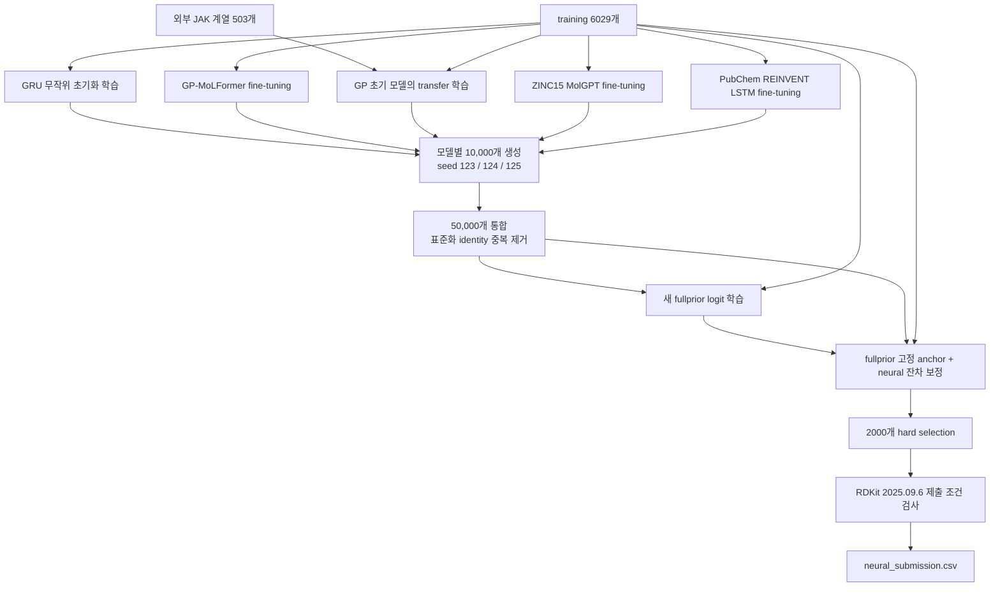

# JAK2 Generator

JAK2 억제 분자 생성 대회용 **5개 생성모델 + 두 단계 학습형 선별기**입니다. 이 저장소는 최종 제출용 코드만 포함합니다. 과거 실험 폴더·후보 CSV·학습 가중치·캐시·대회 데이터는 Git 에 올리지 않습니다.

**`python main.py`를 실행하면 학습부터 최종 2,000개 제출물 생성까지 순서대로 진행합니다.** 학습·생성 시드와 하이퍼파라미터는 최종 선택된 값으로 고정하며 HPO 를 다시 실행하지 않습니다. 실행 전에 아래 데이터·초기 자산 준비가 필요합니다.

최종 채택 원본의 사용자 보고 Kaggle Public 점수는 **60.52285**입니다. 동일 후보를 사용한 fullprior 만의 점수는59.59829였습니다. 이는 저장된 원본 제출의 점수이며, **이 저장소를 새 환경에서 재학습했을 때 동일 점수·동일 CSV 가 나오는지는 아직 검증하지 않았습니다.**

## 조교님용 빠른 실행

### 1. 저장소와 환경 준비

기준 환경은 **Windows / Python3.11.6 / NVIDIA CUDA GPU**입니다. 관측 장비는 RTX5060 Laptop GPU 이며 PyTorch2.12.0+cu130/CUDA13.0을 사용했습니다. GPU 드라이버와 해당 Torch 빌드가 필요하며 CPU 실행은 이 수치 프로필에서 지원하지 않습니다.

```powershell
git clone https://github.com/sanghyeb2/jak2_generator.git
cd jak2_generator
.\setup.ps1
```

`setup.ps1`은 저장소 내부 `.venv`에 requirements.txt 를 설치합니다. 학습은 시작하지 않습니다. 시스템 정책상 스크립트 실행이 제한되면 다음을 수동 실행할 수 있습니다.

```powershell
py -3.11 -m venv .venv
.\.venv\Scripts\python.exe -m pip install -r requirements.txt
```

**새 컴퓨터에서의 설치 성공은 미검증**입니다. 설치 가능한 Torch/CUDA 빌드, Windows/PythonABI, GPU 드라이버 호환성을 확인해야 합니다. 라이브러리를 임의로 최신화하면 결과가 달라질 수 있습니다.

### 2. 비공개 학습 데이터와 공개 초기 자산 준비

대회 규칙상 training 데이터는 외부 재배포할 수 없습니다. 참가자가 대회 검증 목적으로 **별도 전달하는 `private_inputs.zip`**이 필요합니다. 이 ZIP 은 GitHub 에 없습니다. 저장소를 받았다는 사실만으로 데이터 접근 권한을 얻는 것은 아닙니다.

ZIP 에는 원본 training6,029개와 외부 transfer503개가 다음 경로로 들어 있습니다.

```text
inputs/train.csv
generators/data/train.csv
generators/data/jak_transfer_candidates_503.csv
```

아래 명령의 ZIP 경로를 전달받은 파일 위치로 바꿔 실행합니다.

```powershell
.\.venv\Scripts\python.exe .\prepare_assets.py --data-archive "C:\전달받은폴더\private_inputs.zip" --download
```

이 명령은 학습하지 않습니다. ZIP 에서 허용된3개 데이터 파일만 복사하고 보관해 둔 SHA-256과 비교합니다. `--download`는 revision 을 고정한 공개 모델·토크나이저·REINVENT prior 와 소스·ChemNet·별도 runtime 을 준비합니다. 초기 준비에만 인터넷이 필요합니다. 기존 파일의 해시가 다르면 조용히 덮어쓰지 않고 오류로 중단합니다.

- GP-MoLFormer 초기 모델·tokenizer: `assets/`.
- MolGPT/REINVENT 초기 모델: `generators/weights/*/pretrained/`.
- ChemNet: `assets/ChemNet_v0.13_pretrained.pt`.
- MolGPT Transformers4.46.3/tokenizers0.20.3: `runtime/molgpt-runtime/`.
- 공식 제출 검사 RDKit2025.09.6: `runtime/rdkit-2025.9.6/`.

전체 로컬 패키지를 받은 경우에는 이 자산들이 이미 포함되어 있습니다. `--download`는 필요한 파일이 이미 일치하면 해당 다운로드를 건너뜁니다. 외부데이터의 재수집·HPO 는 필요하지 않고 제공된 고정503개를 사용합니다. 출처와 수집 방법은 [docs/DATA_SOURCES.md](docs/DATA_SOURCES.md), 공개 가중치의 ID·revision 은 [docs/ASSETS.md](docs/ASSETS.md)에 있습니다.

### 3. 학습부터 최종 제출물까지 한 번에 실행

실행 계획만 확인하고 싶다면 먼저:

```powershell
.\.venv\Scripts\python.exe .\main.py --dry-run
```

실제 전체 실행:

```powershell
.\.venv\Scripts\python.exe .\main.py
```

기본 실행은 **5개 모델 전체 학습 → 각10,000개 생성 → fullprior → neural → 제출 조건 검사**입니다. 단순히 과거 제출 CSV 를 복사하거나 기존 최고점 분자를 초기값으로 넣는 명령이 아닙니다. 모델은 순차 실행하며 원본 보관 가중치와 제출물을 덮어쓰지 않습니다.

최종 출력:

```text
runs/standalone_seed42/selection/neural_submission.csv
```

파일은 `id,smiles` 두 열이며 id0~1999를 한 번씩 사용합니다. `selection/complete.json`이 생성되고 공식 제출 조건 검사가 PASS 로 끝난 것을 확인한 뒤 CSV 를 Kaggle 에 직접 제출합니다. 업로드·점수 조회는 자동화하지 않습니다.

설정을 바꾸거나 독립 실행을 시작할 때는 새이름을 사용합니다.

```powershell
.\.venv\Scripts\python.exe .\main.py --run-name fresh_repeat_02
```

## 전체 파이프라인



### 1. 다섯 생성모델의 학습

모든 모델은 자기회귀 SMILES 생성 방식입니다. 다음 토큰 예측으로 분자 문법과 학습분포를 학습합니다. 강화학습은 사용하지 않습니다. GP 와 transfer 는 같은 공개 아키텍처에서 다른 학습 경로를 사용하므로 서로 완전히 다른 5종의 아키텍처라는 뜻은 아닙니다.

- **GRU:** 외부 사전학습 없이 시작합니다. Embedding128, 단층 GRU hidden256, Linear 출력. 전체6,029개로150epoch, Adam LR0.002, batch128, StepLR30epoch/gamma0.5, gradient clip1.
- **GP-MoLFormer:** 공개 `ibm-research/GP-MoLFormer-Uniq`에서 시작합니다. 전체6,029개로8epoch/LR1e-5를 학습한 뒤10epoch/LR5e-6를 연속 적용합니다. 단계마다 optimizer 와 seed42를 재설정하며 batch32/AdamW/지원 GPU BF16입니다.
- **Transfer503:** 같은 공개 GP 초기 모델에서 외부 JAK 계열503개3epoch/LR5e-6 → JAK2전체8epoch/LR1e-5 → 다시8epoch/LR1e-5. 외부503개도 생성 결과를 그대로 제출하는 자료가 아니라 학습 입력입니다.
- **MolGPT:** ZINC15 사전학습 GPT 모델에서 전체6,029개로18epoch, LR1e-4, AdamW, batch64로 미세조정합니다. Transformers4.46.3환경에서만 별도 실행합니다.
- **REINVENT RNN:** PubChem 사전학습 LSTM 입니다. Embedding256, hidden512, 3layers, dropout0. 전체6,029개13epoch, LR1e-4, Adam, batch64, float32로 미세조정합니다. 기존 holdout 에서 선택한 설정을 고정합니다.

공통 학습 seed 는42이며 최적화·정밀도·저장 경계의 세부조건은 [하이퍼파라미터.md](하이퍼파라미터.md)에 있습니다.

### 2. 모델당 10,000개 생성

**5개 모델 각각에 대해** seed123→124→125 순서로3,334/3,333/3,333개의 신규 유효·고유 분자를 모읍니다. 합계는 모델별10,000개, 전체50,000개입니다. 세 시드는 여기서 **생성 시드**이며 각 시드로 모델을 따로 학습하는 것이 아닙니다.

동일 모델에서 시드를 넘겨도 중복 집합을 공유하므로3개 시드의 출력이 겹치면 추가로 생성합니다. 각 seed 당 raw draw 예산은100,000개이며 충족하지 못하면 부족한채 제출하지 않고 중단합니다.

- GRU: temperature1.0/batch256/최대256생성 step.
- GP·transfer: temperature0.9/batch32/max_length202.
- MolGPT: temperature1.0/batch64/max_length256.
- REINVENT: temperature0.9/batch128/max_length128.

각 후보 CSV 에는 표준화 SMILES, 중복판정 key, source, seed 가 기록됩니다. seed 별 CSV 와 RNGcheckpoint 도 저장합니다. 실행루프는 `generators/generate.py`입니다. 개별모델 모듈의 과거 CLI 생성부 대신 이 통합루프가 최종 균일 시드 생성프로토콜을 담당합니다.

### 3. 통합과 중복 제거

GP→GRU→transfer→MolGPT→REINVENT 순서, 각 CSV 행순서를 유지합니다. Canonicalization 은 Cleanup/FragmentParent/Uncharge/동위원소·map·H 정리/tautomer 표준화를 적용합니다. 제출 SMILES 의 입체정보는 보존하되 중복 identity 에서는 입체차이를 무시합니다.

동일 key 가 나오면 첫 등장 분자만 보존하고 generated_by 에 어떤 모델에서 생성되었는지를 기록합니다. **중복 횟수에 추가 보상을 주지 않습니다.** 원본 고정50,000개의 고유수는39,167개였지만 새재학습·생성에서도 같은 개수가 된다고 보장하지 않습니다.

### 4. 새 fullprior 학습

Training6,029개를 기준 분포로 사용하고, 후보 전체에 대해 선택 logit 을 직접 최적화합니다. 과거 제출물의 분자별 점수나 과거 선별기 가중치는 가져오지 않습니다.

Training 에서 seed9001로2,000 reference 를 뽑아 Morgan 유사도 기반 greedy 일대일 matching 으로 초기2,000개를 만듭니다. 선택된 후보 logit2.2, 나머지−4.5에서 시작합니다. 초기 집합은 고정 유지가 아니라 최적화의 시작점입니다.

후보·training 을 고정 ChemNet 으로 임베딩하고, training 에만 PCA64와256landmark 를 fit 합니다. sigmoid selection mass 의 합을2,000으로 맞추고, 연속 loss 를 역전파해 전체 후보 logit 을 학습합니다. Adam LR0.03, seed42, 최대 300 updates, eval25, patience4입니다. best 는로컬 hard selection 지표로 정합니다.

### 5. Neural 잔차 보정

Fullprior 가 학습한 **전체 고유 후보의 logit**을 고정 anchor 로 사용합니다. 선택된2,000개만 잘라모델을 학습하는 방식이 아닙니다. 각 후보의387차원특징을 입력받는 MLP387→128→64→1이 다음보정값을 학습합니다.

```text
final_logit = fixed_fullprior_logit + 2*tanh(MLP(features)/2)
```

387차원은 PCA z64/z²64/Morgan training-landmark 특징256/OT 최소·평균2/novelty1입니다. GELU/dropout0/마지막 층0초기화이므로 처음에는 fullprior 와 정확히같은 선택에서 시작해야 합니다. Adam LR0.001, seed42, 최대 300 updates, eval25, patience6입니다. 원본 완료 실험의 best_step 은75였습니다.

### 6. Hard selection 과 제출 검사

선택질량에서 정확히2,000개를 선택하고 최소 novel1,500개 제약을 적용합니다. 동점은안정적인입력 순서로처리하고 ID 순서도고정합니다. 이후별도 프로세스의 RDKit2025.09.6으로 유효·고유2,000개, 허용원소, 탄소포함, heavy atom≤128, 길이조건 등을 검사합니다. 불합격하면 완료 처리하지 않습니다.

## 최적화 loss 와 Kaggle 점수의 차이

두선별단계는 원래성능이좋았던 **지수식 fullprior loss**를 사용합니다.

```text
L = 35*(1-exp(-FCD/5))
    + 35*normalized_OT
    + 15*(1-Novelty)
    + 15*abs(IntDiv_generated-IntDiv_training)

normalized_OT pair cost = (10**(1-Morgan_Tanimoto)-1)/9
```

FCD 는학습중 PCA64근사와초기 조합에서구한 scale 을 사용합니다. OT 는 reference512표본/Sinkhorn epsilon0.08/35iterations, diversity 는 Nyström 근사입니다. best 확인은 full512ChemNet/전체 training OT/exactdiversity 의더큰로컬 평가를사용합니다.

이는숨겨진기준분자를쓰는공식 Kaggle 평가와같지않습니다. 교수님이변경한공식점수는 FCD·OTD 를2.5로나누는선형식이며, **현재훈련 loss 를그식으로교체하지않았습니다.** Public 점수나비공개기준분자는모델 학습에 입력하지 않습니다. training 은분포의 대리 기준이며 높은 로컬 proxy 가 Kaggle 상승을 보장하지 않습니다.

## 출력 구조와 재개

```text
runs/<run-name>/
  generation/
    training/<model>/      새 학습 weight, history, source snapshot
    train_manifests/       학습 입력·코드·완료 weight 해시
    config_<model>.json    생성 설정·공개 초기 자산·weight 해시
    candidates/            모델당10000개 및 seed별CSV
    receipts/              완료생성파일 해시
  selection/
    config.json            고정 입력·코드·환경 기록
    cache/                 후보·reference·ChemNet·Morgan 특징
    fullprior/             학습logit과optimizer/RNG
    fullprior_submission.csv
    neural/                anchor+MLP와optimizer/RNG
    neural_submission.csv
    validation_fullprior.json
    validation_neural.json
    complete.json
  pipeline_complete.json
```

동일 명령을 재실행하면 완료 단계는 설정·해시 확인 후 건너뜁니다. 생성은 batch 경계, MolGPT/REINVENT 는 epoch 경계, 선별기는 checkpoint 경계에서 재개합니다. GRU 는학습 중간 재개를지원하지않고 GP/transfer 의중단 단계학습 상태도 완전히 재개하지 못합니다. 이 경우별도 run-name 으로처음부터 실행합니다.

과거 원본 run 은로컬패키지의`local_artifacts`에보관합니다. 그안의옛 config 절대경로는이력으로남기며새코드로보관 run 을 resume 하지않습니다.

## 선택 실행

전체 과정은기본`main.py`명령입니다. 아래는일부 단계만 실행할 때 사용합니다.

```powershell
# 모델하나만학습
.\.venv\Scripts\python.exe .\main.py --stage train --model gru --run-name train_only

# 저장된5개최종weight로새후보생성 (별도weight전달필요)
.\.venv\Scripts\python.exe .\main.py --stage generate --run-name saved_weights

# 위에서생성한후보만선별
.\.venv\Scripts\python.exe .\main.py --stage select --run-name saved_weights --use-generated

# 원본고정5만후보만으로새선별학습 (별도후보CSV전달필요)
.\.venv\Scripts\python.exe .\main.py --stage select --run-name selection_only
```

fullprior 점수를먼저확인한뒤 neural 을따로실행하려면:

```powershell
.\.venv\Scripts\python.exe .\selection_pipeline.py --stage fullprior --output-dir .\runs\manual_selector
.\.venv\Scripts\python.exe .\selection_pipeline.py --stage neural --output-dir .\runs\manual_selector
```

## 소스 구성

- `main.py`: 전체 학습·균일3시드생성·선별을연결하는기본 실행파일.
- `generators/gru.py`, `gp.py`, `transfer.py`, `molgpt.py`, `reinvent.py`: 모델별 학습·네트워크.
- `generators/common.py`, `generation_utils.py`, `generate.py`: 생성공통함수·uniform sampler·기록.
- `selection_pipeline.py`: 새 fullprior→neural 과공식검사오케스트레이션.
- `selector.py`, `neural_stage.py`, `common.py`, `pipeline_utils.py`: 선별수치계산·표준화·난수·저장.
- `prepare_assets.py`: 비공개 데이터배치와 revision 고정공개자산준비.
- `하이퍼파라미터.md`, `docs/`: 최종설정·출처·재현범위.
- `results/`: 구조가 없는 결과 요약·자산해시.

## 재현성 상태와 검사 범위

원본 완료 실험에는저장 fullprior logit 재추론, neural 실제 forward 재추론, 공식 버전 RDKit 검사가 PASS 로남아있습니다. 채택 CSV SHA-256은`23f6608f7952b496cbc3ddfd9064940e6e9e92e69deea0feb78d5c28ddce8268`입니다. 이는원본실행의기록이며새패키지의전체재현 성공을 뜻하지 않습니다.

이번패키지는**학습·후보생성·전체재현성검증을실행하지않았습니다.** 공개 초기가중치부터의재학습, 새 환경설치, 후보내용·순서일치, 최종 CSV 일치가미검증입니다. 시드만으로 같은 결과를 보장하지 않습니다. GPU 결정성·정밀도·라이브러리버전·동적모듈로딩차이도확인대상입니다.

학습을실행하지않고실행진입점과공개업로드제외목록만검사하려면:

```powershell
.\.venv\Scripts\python.exe -m unittest test_entrypoint -v
```

## 데이터와 제3자 자산

대회 CSV·생성 후보·제출 분자·가중치·runtime·로그·캐시는`.gitignore`와명시적파일목록으로 Git 에서제외합니다. GitHub 웹에전체 로컬폴더를끌어놓지마세요. 조교님에게는비공개 데이터 ZIP 을별도로전달하고공개 초기자산은위준비명령으로받습니다. 저장 weight 재추론이목적이면최종 weight·고정 후보·선별 cache 도별도 전달이필요합니다.

제3자 모델은각출처의라이선스를따릅니다. REINVENT 공식소스와 LICENSE 를함께받도록했습니다. 프로젝트 전체에임의의단일 라이선스를부여하지않았습니다. [docs/DATA_SOURCES.md](docs/DATA_SOURCES.md), [docs/ASSETS.md](docs/ASSETS.md), [docs/REPRODUCIBILITY.md](docs/REPRODUCIBILITY.md)를함께 참고하세요.
